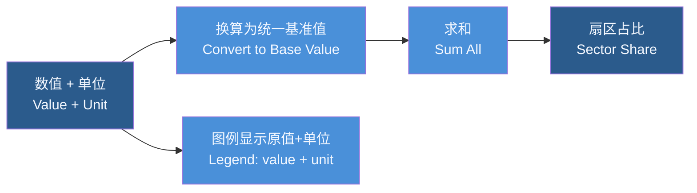

<div align="center">


<a href="#">
  
</a>

一个单文件、零依赖的环形统计图（甜甜圈图）生成器。编辑标题、顶部指标、环形图数据、单位、配色与背景，实时预览并一键导出高清 PNG；内置顶部指标卡片、环形图 + 图例、液态玻璃质感面板与入场动画，适配手机与电脑。

A single-file, zero-dependency donut (ring) chart generator. Edit the title, KPI stat cards, segment data, units, colors and background, preview live, and export a high-resolution PNG in one click. Built-in stat cards, donut with legend, a liquid-glass panel effect, and entrance animations — responsive on mobile and desktop.

</div>

---

## 目录 / Table of Contents

<div align="center">

| 章节 / Section | 快速跳转 / Jump |
| :--- | :---: |
| 项目简介 / Introduction | [前往 / Go](#intro) |
| 功能特点 / Features | [前往 / Go](#features) |
| 快速开始 / Quick Start | [前往 / Go](#quickstart) |
| 使用说明 / Usage | [前往 / Go](#usage) |
| 单位换算 / Unit Conversion | [前往 / Go](#units) |
| 颜色与透明度 / Color & Alpha | [前往 / Go](#color) |
| 背景与液态玻璃 / Background & Glass | [前往 / Go](#background) |
| 动画设置 / Animation | [前往 / Go](#animation) |
| 技术要点 / Tech Highlights | [前往 / Go](#tech) |
| 已知限制 / Limitations | [前往 / Go](#limits) |
| 贡献指南 / Contributing | [前往 / Go](#contributing) |

</div>

---

<h2 id="intro">项目简介 / Introduction</h2>

<div align="center">
  
</div>

环形统计图以环形的扇区面积表达各部分占比，中心留空可放总量或图标，右侧配图例显示名称与数值。本工具把「顶部指标 + 环形图 + 图例」做成一张可直接导出的统计卡片，并在其上叠加液态玻璃质感与入场动画。

A ring chart conveys each part-to-whole share through the area of an annular sector. The hollow center can hold a total or icon, while a legend lists names and values. This tool composes the "stat cards + donut + legend" into one exportable card, layered with a liquid-glass panel and entrance animations.

<div align="center">

编辑数据，右侧实时生成一张这样的卡片：

Edit the data and the card updates live:

```
+--------------------------------------+
|                 预览                 |
|                                      |
|    61         125          29        |
|  新指标       新指标       新指标      |
|                                      |
|      .-''''''.        [色块] 名称 数值 |
|    /   (   )   \       [色块] 名称 数值 |
|    \    `-'    /       [色块] 名称 数值 |
|      `-''''''`                         |
+--------------------------------------+
```

</div>

---

<h2 id="features">功能特点 / Features</h2>

<div align="center">
  
</div>

**中文：**

- **单文件**：整个应用就是一个 `.html` 文件，双击即用，便于分享与部署。
- **零依赖**：纯原生 HTML/CSS/JavaScript 与 Canvas 2D，不引入任何库或框架。
- **顶部指标**：三组（可增减）大数字 KPI 与标签，自动均分排布。
- **环形图 + 图例**：扇区按数值占比绘制，图例显示名称与数值单位。
- **单位换算**：时间 / 长度 / 重量 / 面积 / 数据量分类单位，或「自定义」不换算。
- **颜色与透明度**：直接输入颜色代码，支持 8 位 `#RRGGBBAA` 与透明度滑块。
- **背景可定制**：9 种渐变预设、自定义双色渐变、纯色。
- **液态玻璃**：玻璃质感面板开关 + 磨砂强度三档（绘制进画布，静态）。
- **动画**：顶部指标与环形图分别独立设置类型 / 时长 / 缓动，时长滑行条 0–10 秒，支持时长联动。
- **导出 PNG**：一键导出 2 倍分辨率高清图片。
- **响应式**：设置收进浮动面板，手机与电脑均适配；性能优化，无实时毛玻璃卡顿。
- **中英文切换**：顶栏「中 / EN」滑动开关一键切换整站文案，示例的标题 / 指标名 / 数据名也一并中英互转（自定义名称保持不变）。

**English:**

- **Single file**: The entire app is one `.html` file — double-click to run, easy to share and deploy.
- **Zero dependencies**: Pure vanilla HTML/CSS/JavaScript and Canvas 2D — no libraries or frameworks.
- **Stat cards**: Three (add/remove) big-number KPIs with labels, evenly distributed.
- **Donut + legend**: Sectors drawn by value proportion; the legend shows names and value units.
- **Unit conversion**: Time / Length / Weight / Area / Data categories, or "Custom" (no conversion).
- **Color & alpha**: Type hex codes directly, with 8-digit `#RRGGBBAA` and an alpha slider.
- **Customizable background**: 9 gradient presets, custom two-color gradient, or solid color.
- **Liquid glass**: A glass panel toggle plus three frost levels (painted into the canvas, static).
- **Animation**: Stat cards and the donut have independent type / duration / easing; a 0–10s duration slider with an optional duration link.
- **PNG export**: One-click export at 2x resolution.
- **Responsive**: Settings live in a floating panel; works on mobile and desktop; performance-tuned, no live blur jank.
- **Bilingual UI**: A "中 / EN" sliding switch in the top bar toggles the whole interface; default example names (title / stat / segment) also convert between Chinese and English (custom names are kept).

---

<h2 id="quickstart">快速开始 / Quick Start</h2>

<div align="center">
  
</div>

<details open>
<summary><b>方式 1：直接打开（最简单）/ Option 1: Open directly (simplest)</b></summary>

<br/>

1. 下载 `统计图工具.html`。
2. 双击用任意现代浏览器打开（Chrome / Edge / Firefox / Safari）。
3. 点击右上角「设置」编辑标题、指标、数据、背景与动画。
4. 点击「导出 PNG」保存图片。

1. Download `统计图工具.html`.
2. Double-click to open in any modern browser (Chrome / Edge / Firefox / Safari).
3. Click "设置" (Settings) at the top right to edit the title, stats, data, background and animation.
4. Click "导出 PNG" (Export PNG) to save the image.

</details>

<details>
<summary><b>方式 2：部署到 GitHub Pages / Option 2: Deploy to GitHub Pages</b></summary>

<br/>

1. 将 HTML 文件推送到仓库。
2. 仓库 **Settings → Pages**。
3. Source 选择分支（如 `main`）与目录（`/root`）。
4. 保存后通过 `https://<用户名>.github.io/<仓库名>/统计图工具.html` 访问。

1. Push the HTML file to your repository.
2. Go to **Settings → Pages**.
3. Select the branch (e.g. `main`) and directory (`/root`).
4. Save and visit `https://<your-username>.github.io/<repo-name>/统计图工具.html`.

</details>

<details>
<summary><b>方式 3：其他静态托管 / Option 3: Other static hosting</b></summary>

<br/>

- **Vercel / Netlify / Cloudflare Pages**：拖拽 HTML 文件上传即可。
- **任意静态服务器**：把文件放到 Web 目录，通过 URL 访问。

- **Vercel / Netlify / Cloudflare Pages**: Drag and drop the HTML file to upload.
- **Any static server**: Place the file in the web directory and access it via URL.

</details>

---

<h2 id="usage">使用说明 / Usage Guide</h2>

<div align="center">
  
</div>

界面操作 / Interface Operations

中文：

· 点击右上角「设置」打开浮动设置面板，再次点击或在面板外点击可收起。
· 基础信息：修改标题，增删顶部指标（数值 + 标签）。
· 环形图数据：每项可改名称、数值、单位、颜色；支持增删条目。
· 背景与外观：切换背景样式、液态玻璃开关与磨砂强度。
· 动画设置：分别调整顶部指标与环形图的动画类型、时长（滑行条）、缓动。
· 导出 PNG：导出当前画布的高清图片。
· 中英文切换：点击右上角「中 / EN」滑动开关，整站文案与示例名称（标题 / 指标名 / 数据名）在中文与英文间切换。

English:

· Click "设置" (Settings) at the top right to open the floating panel; click again or click outside to close it.
· Basic info: edit the title and add/remove stat cards (value + label).
· Donut data: edit each item name, value, unit and color; add or remove items.
· Background & appearance: switch background style, glass panel toggle and frost level.
· Animation: tune the animation type, duration (slider) and easing for stat cards and the donut separately.
· Export PNG: export a high-resolution image of the current canvas.
· Language: Click the "中 / EN" sliding switch at the top right to toggle the whole UI and default example names (title / stat / segment) between Chinese and English.

示例名称（随语言切换）/ Default Names (switch with language)

<div align="center">

| 中文 / Chinese | English |
| :---: | :---: |
| 预览 | Preview |
| 新指标 | New Stat |
| 新数据 | New Data |

</div>

输出示例 / Output Example

<div align="center">

| 数据项 / Segment | 数值 / Value | 单位 / Unit | 占比 / Share |
| :--- | :---: | :---: | :---: |
| 单人生存 / Survival | 4.6 | 小时 / hour | 约 9.7% |
| 联机大厅 / Lobby | 8.4 | 小时 / hour | 约 17.7% |
| 网络服 / Online Server | 30.6 | 小时 / hour | 约 64.6% |
| 山头服 / Hill Server | 0.8 | 小时 / hour | 约 1.7% |

</div>

提示 / Note
占比 = 该项统一基准值 / 全部项统一基准值之和。上表同一单位（小时）时，占比即数值占比。

Share = item base value / sum of all base values. In the table above all units are hours, so shares equal value shares.

---

<h2 id="units">单位换算规则 / Unit Conversion</h2>

<div align="center">
  
</div>

每个数据项可从分类里选择单位，或选「自定义」不做换算。绘制扇区时按「统一基准值」计算占比，图例仍显示原始数值与单位。

Each item uses a category unit or "Custom" (no conversion). Sector shares are computed on a unified base value, while the legend still shows the original value and unit.



<div align="center">

| 类别 / Category | 单位 / Units | 基准 / Base |
| :--- | :--- | :---: |
| 时间 / Time | 毫秒 秒 分钟 小时 天 | 秒 / second |
| 长度 / Length | 毫米 厘米 米 千米 | 米 / meter |
| 重量 / Weight | 毫克 克 千克 吨 | 克 / gram |
| 面积 / Area | 平方厘米 平方米 公顷 平方公里 | 平方米 / m² |
| 数据量 / Data | 字节B KB MB GB TB | 字节 / byte (1024) |

</div>

<details>
<summary><b>展开规则 / Expand Rules</b></summary>

<br/>

中文：

· 同一类别的不同单位可混用，例如「4.6 小时」与「30 分钟」会换算到同一基准（秒）再算占比。
· 换算系数：时间以秒、长度以米、重量以克、面积以平方米、数据量以字节（1024 进制）为基准。
· 「自定义」不换算，基准值等于原数值；若与其他类别单位混用，占比按数值直接相加，可能无实际意义。
· 图例始终显示用户输入的原始数值与单位，不会被基准值替换。

English:

· Units of the same category can be mixed, e.g. "4.6 hours" and "30 minutes" are converted to the same base (seconds) before computing shares.
· Base factors: time in seconds, length in meters, weight in grams, area in square meters, data in bytes (base 1024).
· "Custom" performs no conversion (base value equals the raw value); mixing it with category units adds raw values directly and may be meaningless.
· The legend always shows the original value and unit you entered, never the base value.

</details>

---

<h2 id="color">颜色与透明度 / Color &amp; Alpha</h2>

<div align="center">
  
</div>

点击数据项左侧的色块，弹出取色面板：

<details open>
<summary><b>取色面板 / Color Popover</b></summary>

<br/>

· 中文：
  · 原生取色盘：快速选色。
  · 颜色代码输入：支持 `#RGB`、`#RRGGBB`、以及 8 位 `#RRGGBBAA`（末两位为透明度）。
  · 透明度滑块：0–100% 实时调整 alpha。
  · 预设色板：一键选用常用颜色。
  · 色块带棋盘格底，可直观看出透明度；导出 PNG 保留透明效果。

· English:
  · Native color picker: quick selection.
  · Hex input: supports `#RGB`, `#RRGGBB`, and 8-digit `#RRGGBBAA` (last two digits are alpha).
  · Alpha slider: adjust opacity live from 0–100%.
  · Preset swatches: one-click common colors.
  · The swatch shows a checkerboard so transparency is visible; PNG export preserves alpha.

</details>

---

<h2 id="background">背景与液态玻璃 / Background &amp; Glass</h2>

<div align="center">
  
</div>

<details open>
<summary><b>背景样式 / Background Styles</b></summary>

<br/>

· 中文：
  · 预设渐变（9 种）：极夜蓝、石墨黑、暗夜紫、日落橙、深海蓝、极光青、玫瑰金、森林绿、糖果粉。
  · 自定义渐变：两个颜色 + 四种方向（↘ 左上→右下、↗ 左下→右上、↓ 上→下、→ 左→右）。
  · 纯色：单色背景。

· English:
  · 9 gradient presets: Midnight, Graphite, Violet, Sunset, Ocean, Aurora, Rose Gold, Forest, Candy.
  · Custom gradient: two colors + four directions.
  · Solid color: a single background color.

</details>

<details>
<summary><b>液态玻璃 / Liquid Glass</b></summary>

<br/>

· 中文：玻璃质感面板开关 + 磨砂强度三档（轻 · 通透 / 中 · 均衡 / 强 · 雾化）。玻璃效果在下采样 + 模糊后绘制进画布，属静态效果，不做运行时 backdrop-filter，因此滚动、折叠不卡顿、不闪烁。
· English: A glass panel toggle plus three frost levels (Light / Medium / Strong). The glass effect is painted into the canvas after downscale + blur — a static effect, not runtime backdrop-filter, so scrolling and collapsing stay smooth without flashes.

</details>

---

<h2 id="animation">动画设置 / Animation</h2>

<div align="center">
  
</div>

顶部指标与环形图使用两条独立时间线，可分别设置：

Stat cards and the donut run on two independent timelines, each configurable:

<details open>
<summary><b>动画项 / Animation Options</b></summary>

<br/>

<div align="center">

| 项 / Item | 可选值 / Values |
| :--- | :--- |
| 类型 / Type | 生长展开 / 逐段弹出 / 旋转入场 / 整体淡入 / 无动画 |
| 时长 / Duration | 0–10 秒滑行条（0.1 秒步进）/ 0–10s slider (0.1s step) |
| 缓动 / Easing | 缓出 easeOut / 缓入缓出 easeInOut / 线性 linear / 回弹 back / 弹性 elastic |
| 时长联动 / Duration Link | 开启时顶部与图表共用时长；关闭时各自独立 |

</div>

· 「逐段弹出」会让各指标 / 各扇区依次出现；「生长展开」按占比逐步铺开；「旋转入场」整体旋转淡入。
· 「无动画」即时呈现；时长滑到 0 也等同无过渡。

· "Stagger" reveals each stat / sector in sequence; "Grow" sweeps by proportion; "Rotate" spins in and fades.
· "None" renders instantly; a duration of 0 also means no transition.

</details>

---

<h2 id="tech">技术要点 / Technical Highlights</h2>

<div align="center">
  
</div>

<details open>
<summary><b>绘制 / Rendering</b></summary>

<br/>

· 中文：Canvas 2D 绘制，逻辑分辨率 720×664，按设备像素比 2x 渲染保证高清；环形图用 `arc` 绘制内外弧形成扇区，扇区间留小间隙。
· English: Rendered with Canvas 2D at a 720×664 logical size, drawn at 2x device pixel ratio for crispness; donut sectors are built from inner/outer `arc` calls with small gaps.

</details>

<details>
<summary><b>单位与颜色 / Units &amp; Colors</b></summary>

<br/>

· 中文：单位换算为系数表 + 统一基准；颜色解析支持 3 / 6 / 8 位十六进制并转 rgba 绘制。
· English: Unit conversion uses a factor table with a unified base; color parsing accepts 3/6/8-digit hex and draws as rgba.

</details>

<details>
<summary><b>动画 / Animation Loop</b></summary>

<br/>

· 中文：单一 requestAnimationFrame 循环驱动两条进度（progC 图表 / progS 指标），各按自身时长推进，较长的一端结束才停止；输入触发的重绘按帧合并，避免卡顿。
· English: A single requestAnimationFrame loop drives two progresses (progC for chart, progS for stats), each advancing by its own duration and stopping when the longer one ends; input-driven redraws are coalesced per frame to avoid jank.

</details>

<details>
<summary><b>交互与响应式 / Interaction &amp; Responsive</b></summary>

<br/>

· 中文：设置收进浮动面板（点击外部 / Esc 关闭）；断点 640px 适配小屏；导出用 `canvas.toDataURL` 生成 2x PNG。
· English: Settings live in a floating panel (close on outside click / Esc); a 640px breakpoint adapts to small screens; export uses `canvas.toDataURL` for a 2x PNG.

</details>

---

<h2 id="limits">已知限制 / Known Limitations</h2>

<div align="center">
  
</div>

中文：

· 纯前端工具，数据不持久化，刷新后恢复默认示例。
· 扇形占比按「统一基准值」计算；自定义单位不换算，与分类单位混用时按数值直接相加，可能无实际意义。
· 数据量按 1024 进制换算（1 KB = 1024 B）。
· 液态玻璃为画布内绘制的静态近似效果，并非真实光线折射。
· 导出分辨率为当前画布的 2 倍，暂不支持自定义尺寸。
· 界面仅提供中文 / 英文两种语言，未支持其他语言的本地化。

English:

· A pure front-end tool; data is not persisted and resets to the default sample on reload.
· Sector shares use the unified base value; "Custom" units do not convert and, when mixed with category units, are added by raw value and may be meaningless.
· Data sizes use base 1024 (1 KB = 1024 B).
· The liquid glass is a static approximation painted into the canvas, not real light refraction.
· Export resolution is 2x the current canvas; custom sizes are not supported yet.
· Only Chinese / English are supported; no other languages are localized.

---

<h2 id="contributing">贡献指南 / Contributing</h2>

<div align="center">
  
</div>

欢迎提交 Issue 与 PR，建议方向：

· 数据持久化（localStorage 保存当前配置）
· 自定义画布尺寸与更多版式（横向/方形/竖版）
· 中心显示总量或自定义文本
· 图例两列排版与一键统一单位显示
· 切换饼图 / 玫瑰图 / 柱状图
· 导入 CSV 批量填充数据

Issues and PRs are welcome. Suggested directions:

· Data persistence (save current config to localStorage)
· Custom canvas sizes and more layouts (landscape / square / portrait)
· Show a total or custom text in the donut center
· Two-column legend and one-click unified unit display
· Switch to pie / rose / bar chart
· Import CSV to bulk-fill data

提交 PR 前请确保：单文件可独立运行、无新增第三方依赖、手机与电脑表现正常。

Before submitting a PR, please ensure: the single file runs independently, no new third-party dependencies are added, and it works well on mobile and desktop.

---

<div align="center">


如果这个工具对你有帮助，欢迎点一个 Star！

If this tool helps you, please consider giving it a Star!

</div>
